=================================================================

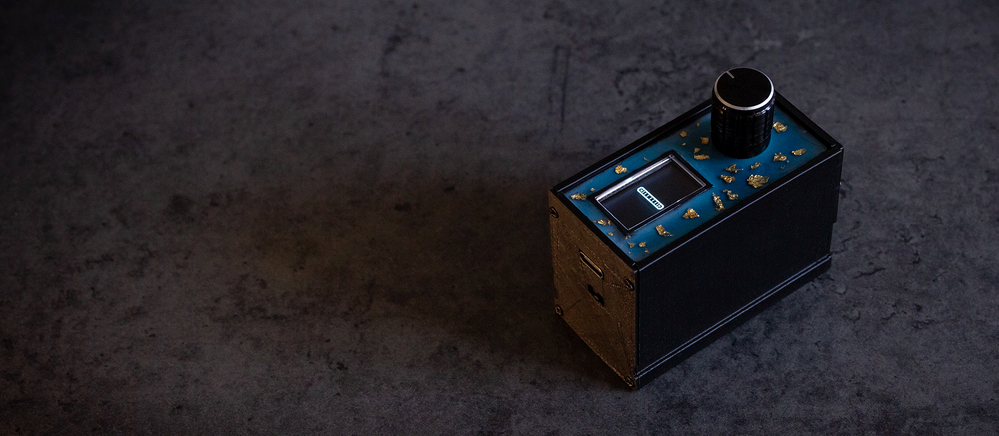

no_DICE is mainly two things (both free and open-source):
* Arduino-based simulator of dice throws, coin flips, and a score counter (using [U8g2](https://github.com/olikraus/u8g2) and [GEM](https://github.com/Spirik/GEM) to draw the menu, and [KeyDetector](https://github.com/Spirik/KeyDetector) to hook up rotary encoder as an input device);
* optional 3D-printed customizable enclosure designed to fit [Seeed Studio XIAO RP2040](https://wiki.seeedstudio.com/XIAO-RP2040/) board (with [Grove Shield for XIAO](https://wiki.seeedstudio.com/Grove-Shield-for-Seeeduino-XIAO-embedded-battery-management-chip/) for power management), 3.7V LiPo battery (in 902030 or 902040 form-factor), 0.96" 128x64 monochrome OLED I2C display, and a rotary encoder (with integrated push-button).

Equip an Arduino-compatible board of your choice with an I2C 128x64 display and a clickable rotary encoder, upload the provided sketch (modify it if necessary to better fit your setup), select an application to roll a die, flip a coin, or track your score with a click and a swing of the encoder. Optionally, add a battery and build an enclosure to take your no_DICE setup on the go! (_Psst! You can also upload your own sketches and customize an enclosure too!_)

* [Online simulator](#online-simulator)
* [For whom](#for-whom)
* [Features](#features)
* [Controls](#controls)
* [Prerequisites](#prerequisites)
  * [Software](#software)
  * [Hardware](#hardware)
* [Enclosure](#enclosure)
    * [Customization ideas](#customization-ideas)
* [Assembly](#assembly)
    * [Electronics](#electronics)
    * [Enclosure assembly](#enclosure-assembly)
* [Battery](#battery)
    * [Charging](#charging)
    * [Monitoring and calibration](#monitoring-and-calibration)
* [Disclaimer and a License](#disclaimer-and-a-license)

Online simulator
----------------

Wokwi simulation of no_DICE will be available soon (using the Raspberry Pi Pico RP2040 board).

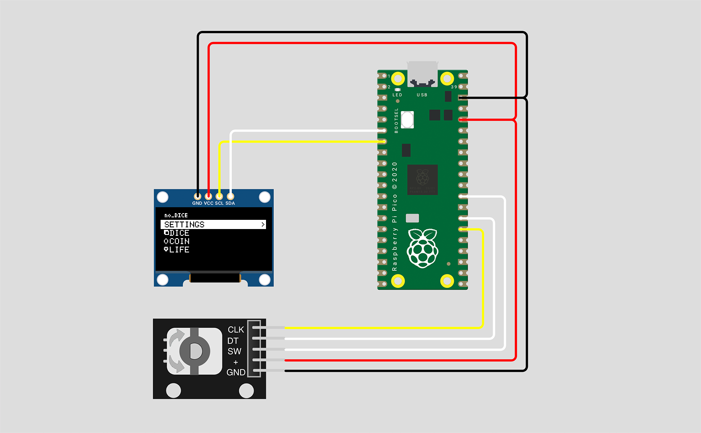

Please note that in the Wokwi simulation the random number generator will be seeded with the same value on each reset of the board, so results will be repeated. In a real RP2040-based board, the random number generator is seeded with multiple samples of the lowest bits of an analog pin as well as an internal temperature sensor of the RP2040 to pick up fluctuations in random noise, battery voltage, and temperature levels.

Preserving settings after a restart or software reset may also not work in the simulator.

For whom
--------

Weekend project for tinkerers and hobbyists who, apart from enjoying working with electronics and Arduino, would like to have physical manifestation of dice-throwing and coin-flipping (not to mention score-tracking) machine on their hands. No need to reach for your phone and launch an app to do just that, amazing, isn't it?

Oh, and you can customize it to your liking, in both physical (by modding its enclosure) and software (by writing custom functions) ways! You can even ask your favorite AI agent to do that for you! (No AI assistance was used in writing code or modeling enclosure for this project so far, but I won't judge you if you'd like to use one, I promise!)

You can use no_DICE firmware with different hardware and totally different enclosure; or use enclosure for your own project (please, do) without dice-throwing firmware (who needs it anyway, you have your phone right there with you at all times).

And if you are interested in learning more about [GEM](https://github.com/Spirik/GEM) (a.k.a. _Good Enough Menu_) and how to use it in your own project, this can be a great source of inspiration and insights on possible implementation of different features (menu hierarchy, callbacks, custom icons, context, localization, etc.).

Feel free to share your experience: whether you implemented the code, enclosure or the whole build.

Features
--------

* __Dice throwing:__ choose from a wide variety of dice: `D4`, `D6`, `D8`, `D10`, `D12`, `D20`, `D100`. Set default preferred dice in settings.
* __Coin flipping:__ not really much to say about it, just press a button and coin will be flipped. With glorious sprite animation. Result of a coin toss is determined at a key press, but coin itself flips random amount of times (2-4) so that it is harder to predict an outcome by seeing the initial frame of animation.
* __Life tracking:__ not just _Life_, really, but points in general. Turn the knob and number will increase (or decrease) at your will. Press the knob to reset the number to its initial starting value (adjustable in settings). Any value you desire is fine (as long as your desire falls within the range of -999 to 9999).
* __Localization:__ English, Russian, German, and French languages are available to pick from in settings.
* __Battery monitoring:__ can be enabled in settings. Requires additional hardware modification (in the form of a voltage divider comprised of two identical resistors soldered to Grove Shield).
* __Random number generator:__ is seeded with multiple samples of the lowest bits of an analog pin as well as an internal temperature sensor of the RP2040 (on compatible boards) to pick up fluctuations in random noise, battery voltage, and temperature levels.
* __Enclosure__: you can 3D-print it: STL files are provided. You can modify it too: .f3d (Fusion) and STEP files are provided as well.

Controls
--------

Rotary encoder is used to navigate menu and interact with applications.

| Encoder                  | Key identifier   | Action                 |
|--------------------------|------------------|------------------------|
| Rotate CW                | `GEM_KEY_DOWN`   | `Down`: navigate down through the menu items list, select next option in select, increase value of a life counter |
| Rotate CCW               | `GEM_KEY_UP`     | `Up`: navigate up through the menu items list, select previous option in select, decrease value of a life counter |
| Rotate CW while pressed  | `GEM_KEY_RIGHT`  | `Right`: navigate through the link to another (child) menu page, press button, select next dice variant |
| Rotate CCW while pressed | `GEM_KEY_LEFT`   | `Left`: navigate through the Back button to the previous menu page, select previous dice variant |
| Short press              | `GEM_KEY_OK`     | `OK`: toggle switch, enter edit mode of the associated variable/select, exit edit mode with saving the variable, press button, throw a die, flip a coin, reset a life counter to a default value |
| Long press               | `GEM_KEY_CANCEL` | `Cancel`: navigate to the previous (parent) menu page, exit edit mode without saving the variable, exit application (i.e. Dice, Coin, Life) |

Prerequisites
-------------

### Software

Use your favorite method to compile and flash provided [`no_DICE_gem-u8g2`](/src/no_DICE_gem-u8g2/) sketch to a board (e.g., Arduino IDE/CLI, PlatformIO, etc.). Tested on Arduino Uno R4 (Minima), Seeed XIAO RP2040, and Wemos D1 R32 ESP32 Dev boards.

In case of RP2040-based boards, make sure to use Earle Philhower's [Arduino-Pico core](https://github.com/earlephilhower/arduino-pico) instead of default one shipped with Arduino (Wokwi simulation uses Arduino-Pico core as well). Refer to [documentation](https://github.com/earlephilhower/arduino-pico#installing-via-arduino-boards-manager) for installation process.

### Hardware

The following list of components can be used to build no_DICE. The result will be compatible with the [enclosure](#enclosure). Different components can be used, but compatibility with the enclosure isn't guaranteed in that case.

| Component                                                         | Links/Notes            |
|-------------------------------------------------------------------|------------------------|
| Seeed Studio XIAO RP2040                                          | [wiki](https://wiki.seeedstudio.com/XIAO-RP2040/) |
| Seeed Studio Grove Shield for XIAO                                | [wiki](https://wiki.seeedstudio.com/Grove-Shield-for-Seeeduino-XIAO-embedded-battery-management-chip/)  |
| 0.96" 128x64 monochrome OLED SSD1306 I2C display                  | [ali](https://share.google/ERkxkYSbAKC9BMNqD), [amazon](https://www.amazon.com/dp/B09T6SJBV5); PCB dimensions ~25x27mm; in case of different display controller (e.g. SH1106), update U8g2 constructor accordingly |
| EC11 rotary encoder (with push-button), discrete or PCB           | [ali](https://aliexpress.com/item/1005003516327678.html?sku_id=12000026140620257), [amazon](https://www.amazon.com/dp/B0GDX2BBV1), [ali (PCB)](https://share.google/XG3rEILkkhtFXhwrv), [amazon (PCB)](https://www.amazon.com/360-degree-infinite-rotation-counting-fine-tuning/dp/B0HKH3729H); usually 15mm half-handle option |
| Knob for EC11 rotary encoder                                      | [ali](https://aliexpress.ru/item/1005003516327678.html?sku_id=12000026140620261), [amazon](https://www.amazon.com/dp/B0GDX6C31D) |
| 3.7V LiPo battery (in 902030 or 902040 form-factor) w/ PH 2.0mm 2-pin connector | [ali (902030)](https://aliexpress.com/item/1005003617413715.html?sku_id=12000026516098585), [ali (902040)](https://aliexpress.com/item/1005006995943957.html?sku_id=12000038987399868); 500mAh - 1000mAh capacity should be plenty |
| Set of 4-pin Grove cables, w/ or w/o buckle (for display and encoder connection) | [ali](https://share.google/dp2iQiyECcmwmOsxS), [amazon](https://www.amazon.com/4-Pin-Compatible-lengths-buckled-connectors/dp/B0HCPG2LQT); 5cm length is enough |
| Set of PH 2.0mm 2-pin male/female cables (for battery connection) | [ali](https://share.google/d0DIl9R03D3pMEQMi), [amazon](https://www.amazon.com/dp/B0D9R21XYY); 10cm length is enough; make sure that black/red wire orientation matches that of a battery (if it comes with connector already attached) |
| Pair of identical resistors (2x 100K, or 2x 220K, etc.)           | optional, if you choose to use voltage divider to measure battery level |
| M1.7x4 or M2x4 self-tapping screws for enclosure | [ali](https://aliexpress.com/item/1005002323316115.html?sku_id=12000020082868922), [amazon](https://www.amazon.com/dp/B0D7QHSHCT); optional, but recommended to better secure side panels of an enclosure |
| 2mm acrylic glass for top cover of an enclosure, cut for dimensions: 13x23x2mm | [ali](https://aliexpress.com/item/1005002519387893.html?sku_id=12000023059884118); optional, transparent or slightly tinted |

Note that if you choose to use a different board, you may have to adjust some settings in the sketch (e.g. pins to which display and rotary encoder are connected).

Enclosure
---------

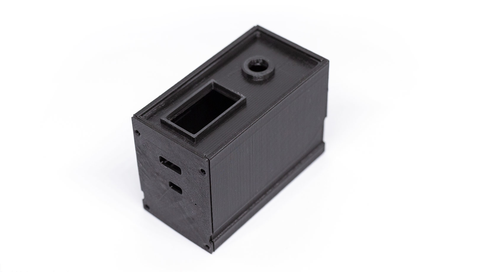

Optional enclosure can be 3D-printed using provided STL files. Autodesk Fusion project file (.f3d) and STEP files are provided as well.

Parts designed with no overhangs (except for screw holes on the bottom of the main frame).

Tolerances are not very precise and adjusted to produce decent results on Snapmaker 3-in-1 Original printer with 0.2mm (frame, top cover, spacer) and 0.1mm (side panels; switch skirt was printed at 0.05mm) layer height using PLA filament. Your mileage may vary, so a bit of sanding (or even clipping off some latches in case of tight fit) may be required.

Holes for screws are provided. Screws are optional, but recommended (and depending on how well model tolerances and latches will work out for you, can even be necessary). I recommend using M1.7x4 or M2x4 self-tapping screws. Longer screws (up to 6mm) can be used, but additional drilling may be required (to make holes go deeper).

Optional protective glass over the display screen can be installed in the top cover part. Dimensions of the opening are 23.2x12.8mm. I have experience ordering acrylic glass pieces with the specified dimensions of 23x13x2mm, and given their quite loose tolerances, they press-fit in the provided opening rather well. Although in some cases additional drop of glue (or sanding) can make things even better.

Both long (unmodified) and shortened versions of the Grove Shield (with clipped off part with additional ports) are supported. Using shortened version can provide additional space inside the enclosure, that can be utilized for further modifications and customizations of hardware and features, e.g. installing additional sensors. Although you may want to keep full-sized Grove Shield exactly for that reason, given that it provides extra ports for convenient connection of additional hardware.

When using shortened version of Grove Shield, it is recommended to install spacer part to act as a stop and prevent Grove Shield from moving inside too much if friction proves to be not enough to hold it in place reliably (especially when connecting and disconnecting USB-C cable).

### Customization ideas

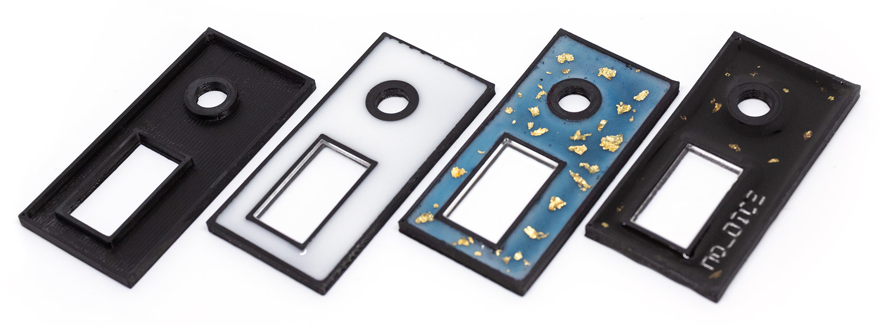

Use different materials to print (or CNC?) parts of the enclosure. Place custom insets in recess of the top cover. Fill it with color epoxy. Place something in that epoxy. Use a display with a different OLED color. Use colored acrylic glass over the display. Find a fancy knob for the rotary encoder. Modify provided enclosure files or make your own from scratch using your favorite CAD program. Go wild, or do completely none of that (and go wild anyway).

Assembly
--------

### Electronics

This is how the whole setup looks, with voltage divider (for battery monitoring) and discrete rotary encoder:

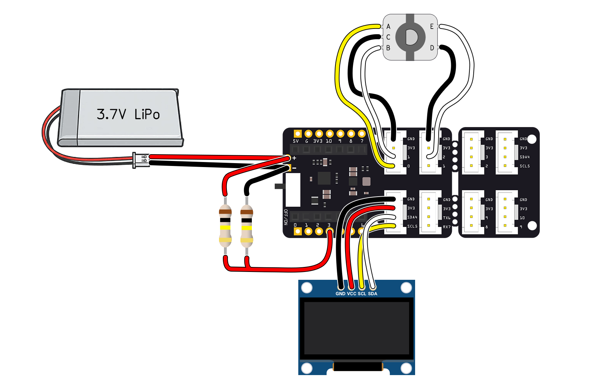

And this is the version with a rotary encoder module on a PCB:

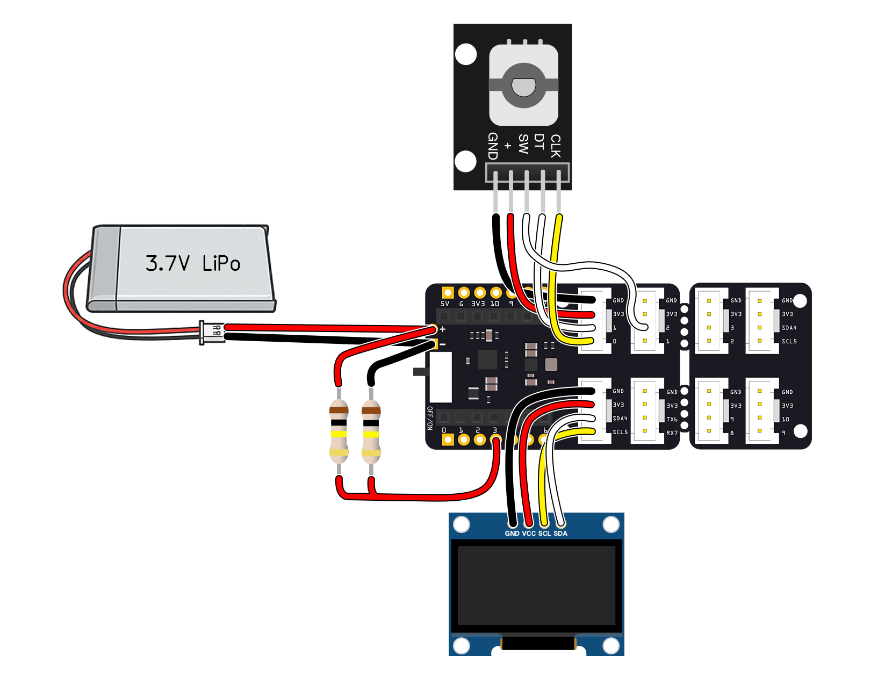

1. Decide whether you want to use shortened modification of Grove Shield (with clipped off part with additional ports) or unmodified full version. Act accordingly to clip off part of a board (if you decided to).  
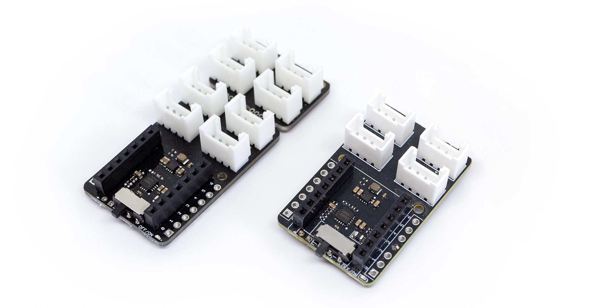
2.
    a) If you don't need battery level monitoring, solder male PH 2.0mm 2-pin header to battery in contacts on a back side of a Grove shield.  
    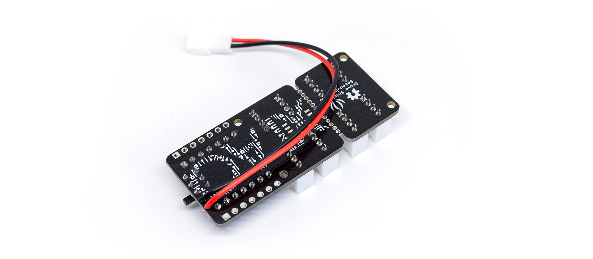  
    b) If you want to use battery monitoring, assemble voltage divider first, comprised of a pair of identical resistors (e.g. pair of 100K resistors), soldered to the back of a Grove Shield as shown below. Solder male PH 2.0mm 2-pin header to battery in contacts of a Grove shield as well.  
    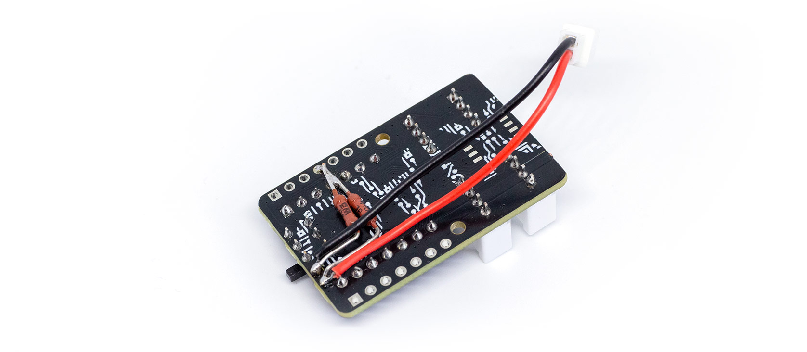
3. Solder pin headers to XIAO RP2040 board (if they're not installed already).  
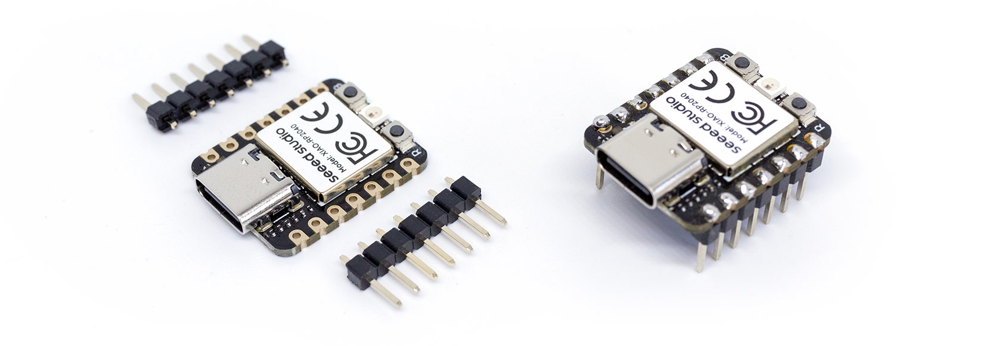
4. Attach XIAO RP2040 board to a Grove Shield.  
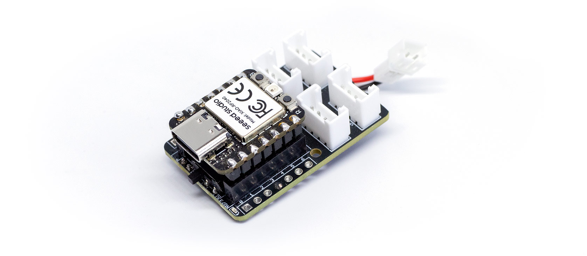
5. Remove pin headers from display board.  
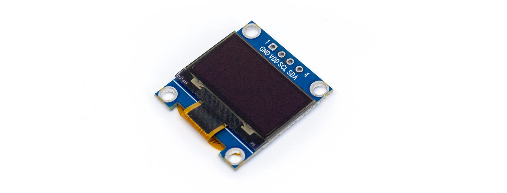
6. Grab a Grove cable and cut it roughly to 38mm-40mm in length (connector included). Strip wires on the cut end of a cable.

7. Connector end of a cable will go into I2C slot of a Grove Shield, with its pinout silkscreened onto the board. Study it carefully and solder each wire of a cable to corresponding pin holes of a display board.  
    | Grove Shield Pin | Display Pin | Wire        |
    |------------------|------------ |------------ |
    | GND              | GND         | ⚫️ Black     |
    | 3V3              | VDD         | 🔴 Red       |
    | SDA\|4           | SDA         | ⚪️ White     |
    | SCL\|5           | SCL         | 🟡 Yellow    |
    
    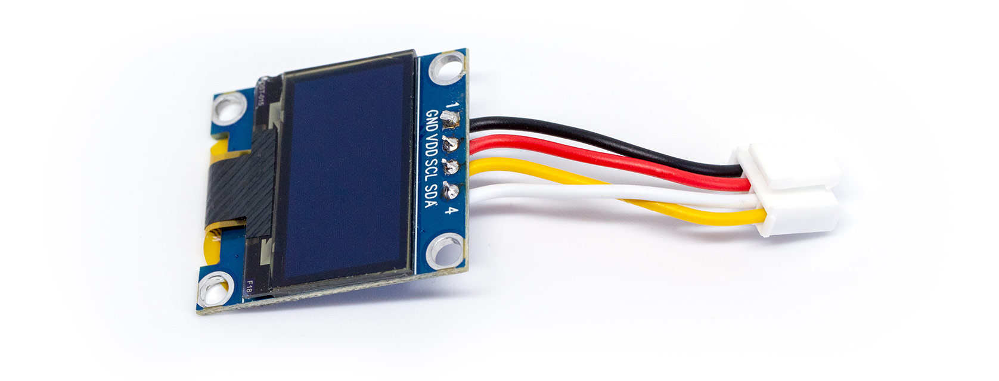
8. Prepare two more pieces of grove cable cut to around 38-40mm in length (connector included).  
    a) If you are planning to use discrete rotary encoder part, detach (unclip from a connector side or cut off flush) red and yellow wire from one of the cables completely. Remove red wire from the second cable. Strip wires on the cut end of the cables.  
    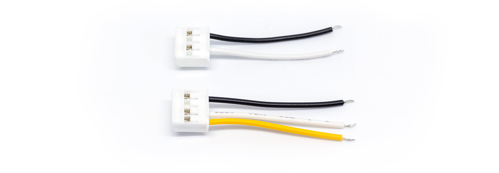  
    b) If you are planning to use rotary encoder module on PCB, detach (unclip from a connector side or cut off flush) black, red, and yellow wires from one of the cables completely. Leave all wires of the second cable in place. Strip wires on the cut end of the cables.  
    
9. Connector ends of these cables will go into two slots of a Grove Shield.  
    a) In case of a discrete rotary encoder part, solder prepared cables according to table (actual naming scheme of the encoder pins may differ from model to model):  
    | Grove Shield Pin | Encoder Pin | Wire                  |
    |------------------|------------ |-----------------------|
    | GND              | C           | ⚫️ Cable 1 - Black     |
    | 1                | B           | ⚪️ Cable 1 - White     |
    | 0                | A           | 🟡 Cable 1 - Yellow    |
    | GND              | D           | ⚫️ Cable 2 - Black     |
    | 2                | E           | ⚪️ Cable 2 - White     |

    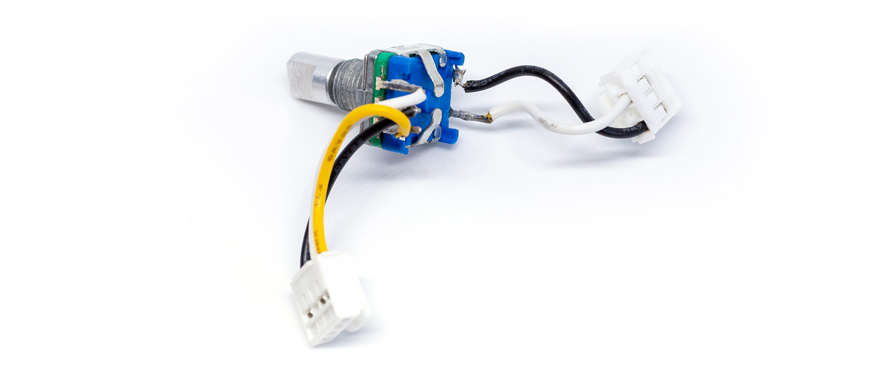  
    b) In case of a rotary encoder module on PCB, solder prepared cables according to table (actual naming scheme of the encoder pins may differ from model to model):  
    | Grove Shield Pin | Encoder Pin | Wire                  |
    |------------------|------------ |-----------------------|
    | GND              | GND         | ⚫️ Cable 1 - Black     |
    | 3V3              | +           | 🔴 Cable 1 - Red       |
    | 1                | DT          | ⚪️ Cable 1 - White     |
    | 0                | CLK         | 🟡 Cable 1 - Yellow    |
    | 2                | SW          | ⚪️ Cable 2 - White     |

    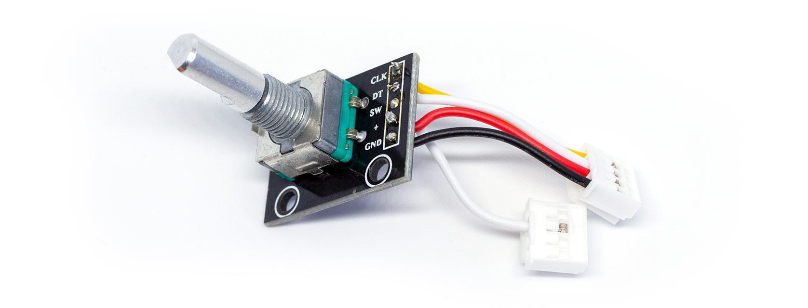
10. Connect the display and encoder to the corresponding connectors of the Grove Shield.  
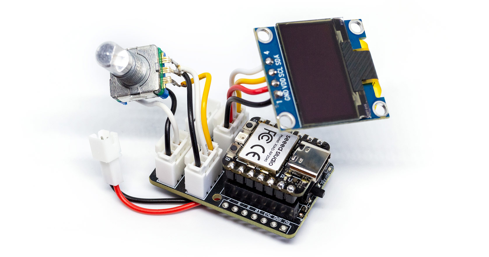
11. At this point connect the whole assembly to a computer using USB-C port on XIAO board. Upload sketch and check that everything is working as expected. Adjust connection of encoder pins (or their designation in sketch) if necessary.
12. You may also want to check whether power supply via battery is working properly. For that, disconnect USB-C cable from a board to power it off. Then connect battery to a male PH 2.0mm 2-pin header soldered to a Grove Shield in step 2. If your battery didn't come with presoldered female connector, solder it to the battery leads. Mind the polarity of the wires. Use multimeter to check voltage if unsure. Refer to silkscreen markings of battery-in contacts on a back side of a Grove Shield.  
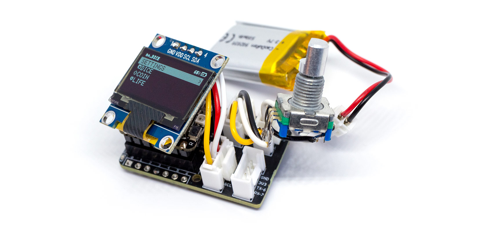

### Enclosure assembly

3D-print the following parts necessary for assembly:
* [Frame](/hardware/enclosure/frame/) (base of the whole enclosure)
* [Top cover](/hardware/enclosure/top-cover/) (also includes an SVG file with the inset outline for possible customization)
* [Side IO cover](/hardware/enclosure/side-io-cover/) (also includes an SVG file with the outline for possible custom CNC machining of the part)
* [Side cover](/hardware/enclosure/side-cover/) (also includes an SVG file with the outline for possible custom CNC machining of the part)
* [Switch skirt](/hardware/enclosure/switch-skirt/) (optional)
* [Spacer](/hardware/enclosure/spacer/) (if shortened version of Grove Shield is used)

Source project files with the whole list of parts are also [available](/hardware/enclosure/):
* Fusion .f3d project file
* STEP file (exported from Fusion project)
* PDF file (selection of parts printed from Fusion drawing)

Finish 3D-printed parts if necessary (clean-up, sand, paint, etc.). Optionally prepare protective acrylic glass piece for the top cover and set of screws.

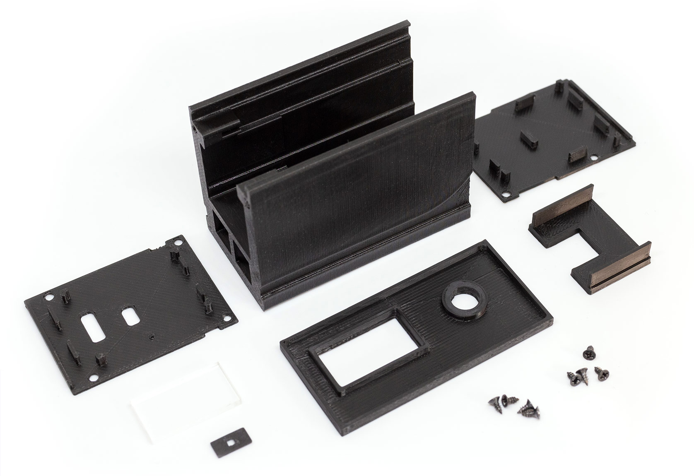

1. Apply decor to top cover (if desired). Insert protective acrylic glass into the rectangular recess in a top cover (if desired). Fit should be tight, otherwise secure with glue. If glass doesn't fit, adjust size of the glass and/or the recess with sanding and/or filing.  
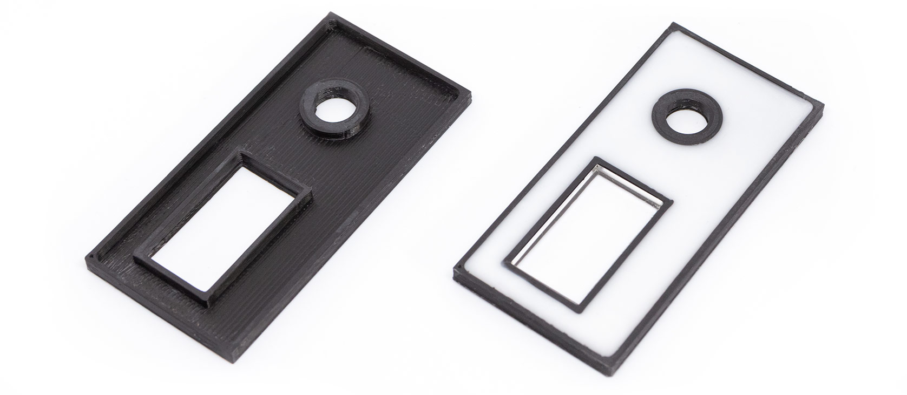
2. Attach switch skirt to a power switch handle of a Grove Shield. Make sure that switch moves freely with skirt attached.  
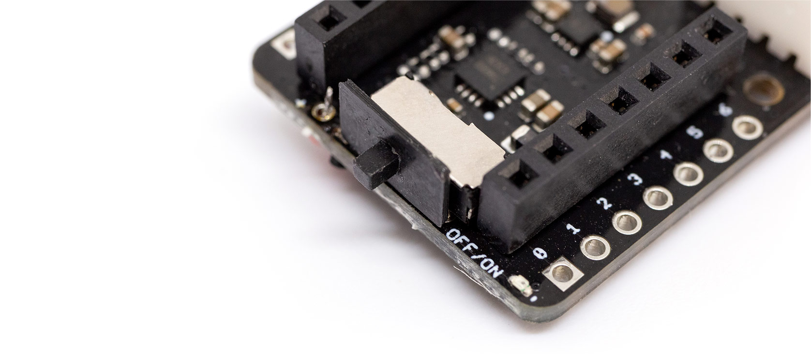
3. Pull shaft of the encoder through the circular hole in a top cover. Secure with nut (but not tighten all the way just yet).  
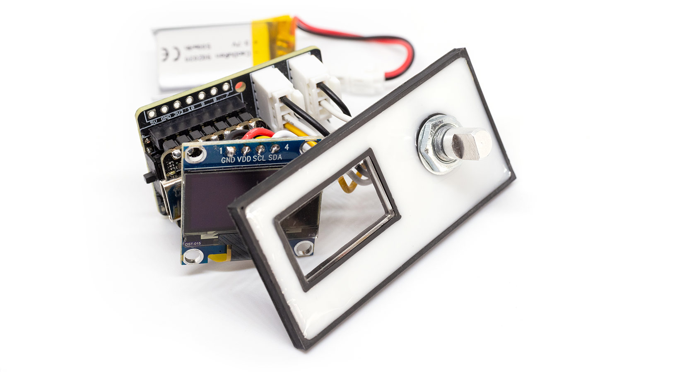
4. Align top cover with the top slot of the frame. Then slowly slide the whole assembly into main frame of an enclosure. Channels in the inner side of the frame will guide assembly inside. Mind the ribbon connector of the display assembly (which connects PCB to the screen) - make sure not to damage it while sliding into designated slots of the frame. Align display with the window in top cover. That may be tricky. Use stick to gently push assembly inside from the back side. Push battery all the way inside of the bottom compartment. Tighten rotary encoder.  
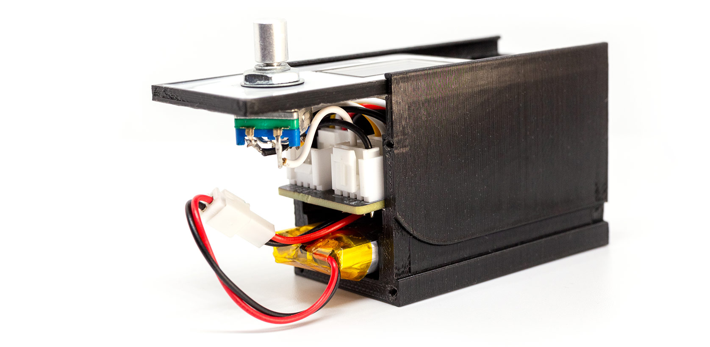  
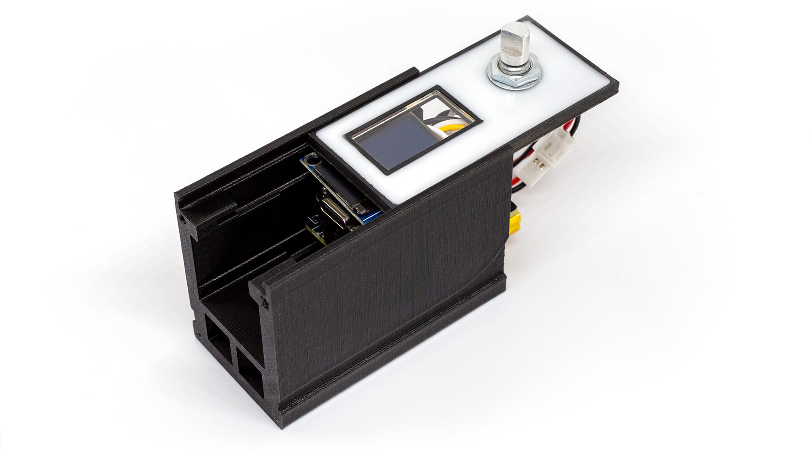  
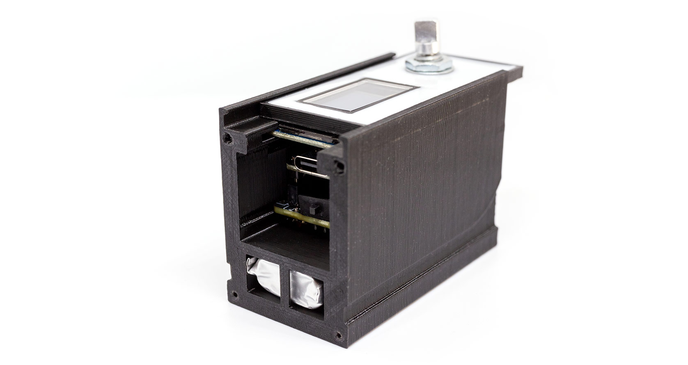  
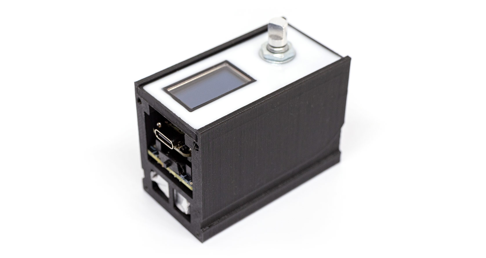  
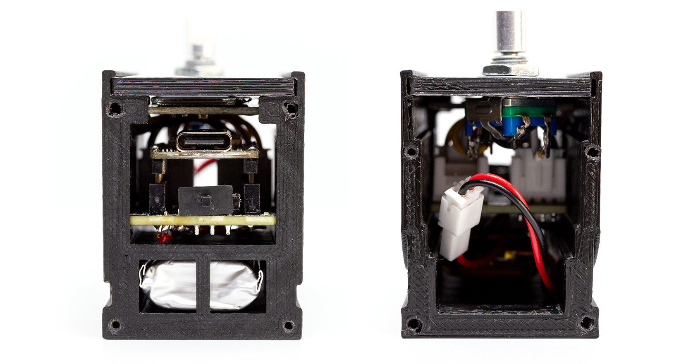  
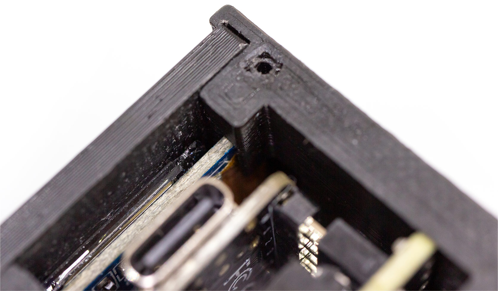
5. If shortened version of Grove Shield is used, place spacer inside of the frame at the level of Grove Shield.  
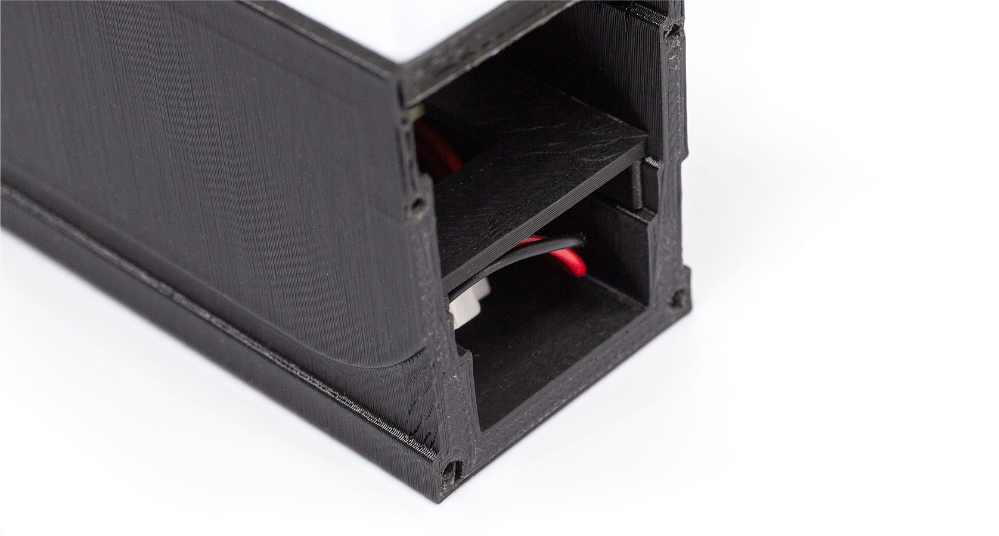
6. Attach side IO cover. Align it carefully with USB-C port of the XIAO. If necessary, lift (or press down more) XIAO board for better alignment. Cover should latch in place. If it doesn't fit - clip out some latches. If it doesn't sit firmly enough - secure with four M1.4x3 or M2x3 screws. Cover has a hole for charging LED of Grove Shield, to make it more easily readable - drop a tiny amount of transparent epoxy to act as a light guide.
7. Attach second side cover. Secure with screws if necessary.  
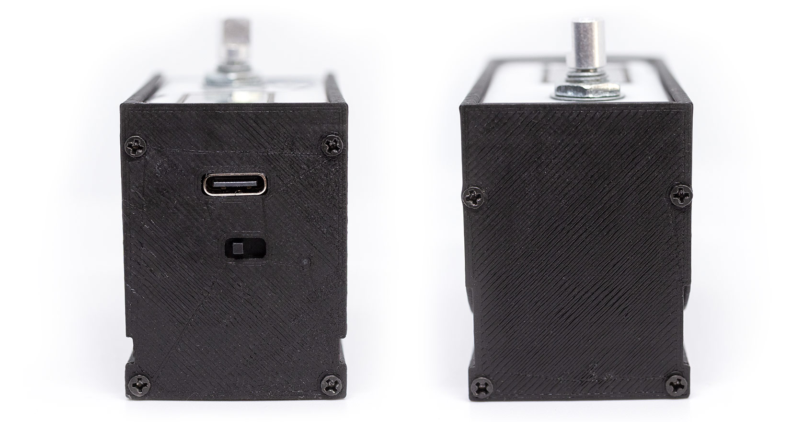
8. Attach the knob. Assembly is complete!  
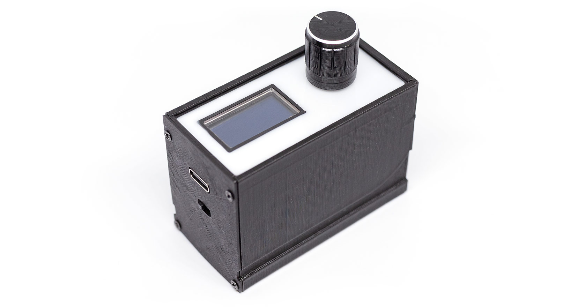
9. Slide power switch on the Grove Shield to the right position (when looking straight at the IO side) to power assembly on from the battery. Slide it to the left to power it off.  
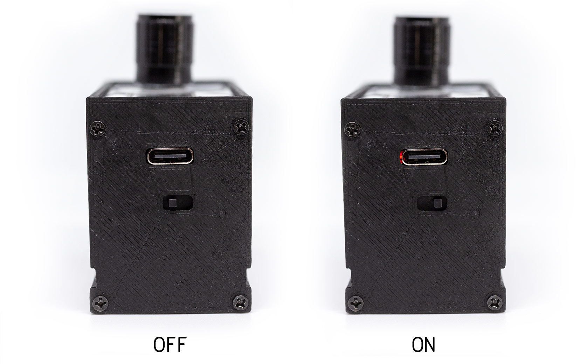

Battery
-------

### Charging

Grove Shield charges battery via USB-C port of attached XIAO board whenever cable is connected. It is equipped with on-board charging status LED indicator (there is strategically placed hole in side panel of the enclosure to make LED visible). If power is connected when power switch is in Off position, charging LED blinks constantly, regardless of charge level. If power is connected when power switch is in On position, charging LED will be lit on when charging is in progress and will be turned off when battery is charged.

### Monitoring and calibration

If you choose to implement a voltage divider for battery voltage measurement, it is possible to enable battery monitoring via Settings menu. Go to `SETTINGS`>`BATTERY` and switch Monitoring to "On". You can enable battery icon indicator to be displayed in top right corner of a screen and/or percentage value.

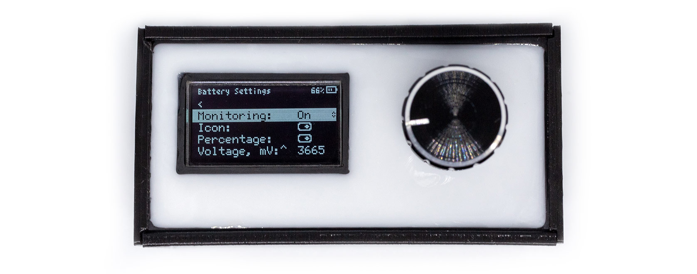

Conversion of battery voltage reading to battery charge level is quite rough and imprecise. To make it slightly better it is recommended to calibrate it for your battery specifically. To do so, charge battery completely with power switch in On position, until charging LED goes out. Then disconnect power and note the Voltage reading in Battery Settings menu (reading is updated every 10s, so wait a little after disconnecting the cable to get more relevant value). This is your fully charged voltage level. Then wait until device starts spontaneously rebooting (it can take anywhere from 6 to 9 hours or even longer depending on battery capacity). Note the Voltage reading in Battery Settings menu again. This is your discharged battery level. Open `constants.h` file in source code and adjust `BATTERY_MAX` and `BATTERY_MIN` values accordingly. Reupload modified sketch to your board.

It is possible that you would need multiple passes of this process to achieve better precision. However it won't be perfect in any case.

Additionally, keep in mind that voltage reading (and hence battery level) can be incorrect when external power is connected.

Disclaimer and a License
------------------------

Common sense and basic knowledge of electrical engineering are required for safe use of this project. The author assumes no liability for any property damage or injury resulting from unintentional or otherwise improper use or implementation of this project (or any portion thereof).

### Software License

Software provided in this project is free software; you can redistribute it and/or modify it under the terms of the GNU Lesser General Public License as published by the Free Software Foundation; either version 3 of the License, or (at your option) any later version.

This software is distributed in the hope that it will be useful, but WITHOUT ANY WARRANTY; without even the implied warranty of MERCHANTABILITY or FITNESS FOR A PARTICULAR PURPOSE. See the GNU Lesser General Public License for more details.

You should have received a copy of the GNU Lesser General Public License along with this software.  If not, see <http://www.gnu.org/licenses/>.

### Hardware License

Hardware provided in this project is licensed under the terms of the CERN OHL v2 Permissive license, except for the datasheets (if any) of the components used to build this project, which are distributed for reference only and may be subject to different license terms.

You should have received a copy of the CERN OHL v2 Permissive license along with this project.  If not, see <https://cern-ohl.web.cern.ch/>.